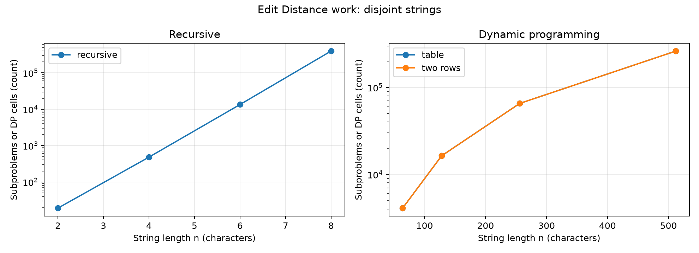
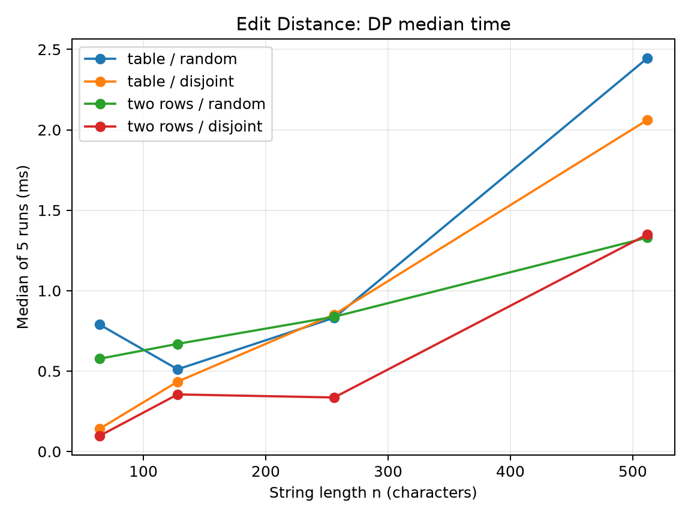
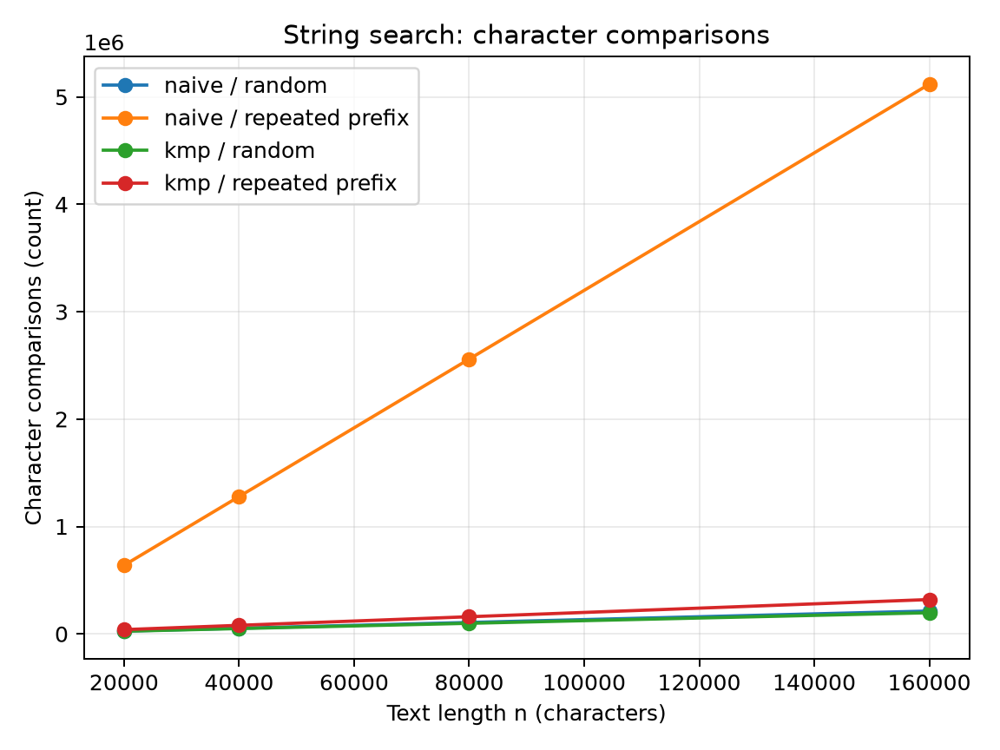
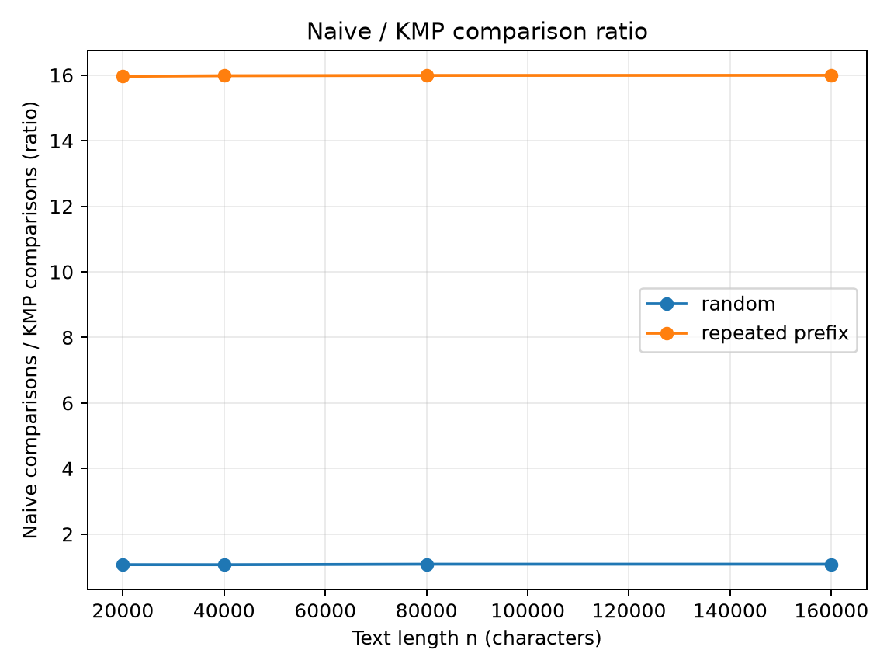

# Assignment 4: Dynamic Programming and String Algorithms

Java 25 and Maven project scaffold for the assignment.

## Build and test

```sh
mvn test
```

## Experiment design card

| Field | Edit Distance | String Search |
| --- | --- | --- |
| Question | How do recursion, full table, and two rows scale in work and time? | How does KMP compare with naive search on random and adversarial text? |
| Sizes | Recursion: 2, 4, 6, 8. DP: 64, 128, 256, 512. | Text length: 20,000, 40,000, 80,000, 160,000; pattern length: 32. |
| Inputs | Seeded strings from a four-character alphabet and strings from disjoint alphabets that force edits. | Seeded random text and pattern; repeated `a` text with a pattern of 31 `a` characters followed by `b`. |
| Metrics | Recursive subproblem evaluations or interior DP cells, counted inside the algorithm, plus time in milliseconds for each of five runs. | Character comparisons in Naive and in KMP prefix construction plus search, counted inside the algorithm, plus time in milliseconds for each of five runs. |
| Prediction | Recursive work will rise sharply on disjoint strings. Both DP versions will fill n² interior cells. | Random inputs will have similar costs. Repeated prefixes will cause many more Naive comparisons than KMP comparisons. |
| Plots | Work versus n with a logarithmic y-axis; median DP time versus n. | Comparisons versus text length; Naive/KMP comparison ratio versus text length. |

The fixed generator seed is `20261107`. The counter values are reproducible. Times vary with machine load; charts show the median of five runs.

## Run the experiment

```sh
mvn -q -DskipTests package
java -cp target/classes org.example.Benchmark
python results/plot_results.py
```

The benchmark writes one row per measured run to `results/results.csv`. The plot script requires `matplotlib` and writes PNG files to `results/plots/`.

## Results



On disjoint strings of length 8, recursion evaluated 398,593 subproblems, while both DP versions updated exactly n² interior cells at each size.



At n=512 on disjoint strings, the table took a median 2.0614 ms and two rows took 1.3496 ms; smaller timings fluctuated.



On the repeated-prefix input at n=160,000, Naive made 5,119,008 comparisons and KMP made 320,030.



The repeated-prefix case required about 16 times as many Naive comparisons as KMP comparisons, matching the prediction that KMP avoids rechecking long prefixes.

### Prediction versus observation

The Edit Distance counters matched the prediction: disjoint strings drove recursive work up rapidly, while both DP versions filled n² cells. The recursive random pair at n=8 needed only 13,622 evaluations, showing why input choice matters. The DP time curves broadly rose with size, though individual small measurements did not always increase.

For string search, the repeated-prefix input exposed the expected gap. The random input produced much closer comparison counts for Naive and KMP. The KMP counter includes LPS construction, so the comparison is for the complete search task.

### Short answers

The repeated-prefix input made Naive search slowest. At nearly every starting position it matched 31 `a` characters before failing on `b`. KMP reused the prefix information instead of repeating those comparisons.

The recursive Edit Distance experiment reached n=8 on both input types. It already evaluated 398,593 subproblems on the disjoint pair. The rapid growth of repeated calls, rather than memory, set the practical limit for this experiment.

Two rows reduce auxiliary memory from O(nm) to O(m), while keeping O(nm) time. The full table preserves every intermediate value. With two rows, reconstructing the sequence of edits directly is no longer straightforward.

For the city platform, I would choose KMP for long logs because repeated-prefix text can make Naive search do much more work. Both implementations return the same match positions in the tests, including overlaps. Naive search remains simpler for very short inputs, but the counter data favors KMP for the stated workload.

The recorded times generally grew with input size, but JVM warmup, allocation, and machine load caused noise in short runs. Each plotted time is a median of five measurements. The counters are deterministic for a given input and provide the stronger evidence for growth behavior.


