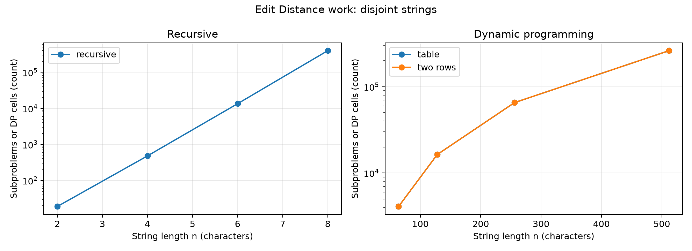
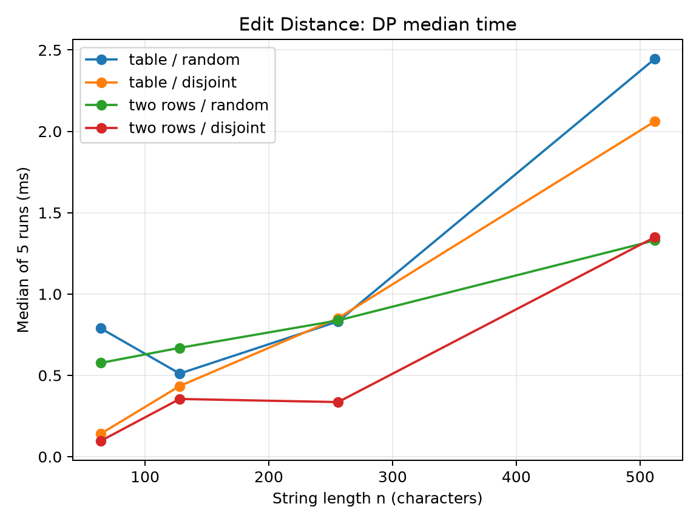
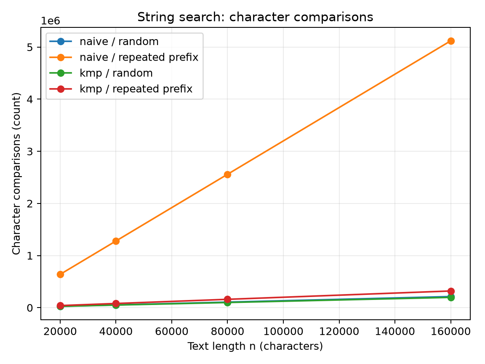
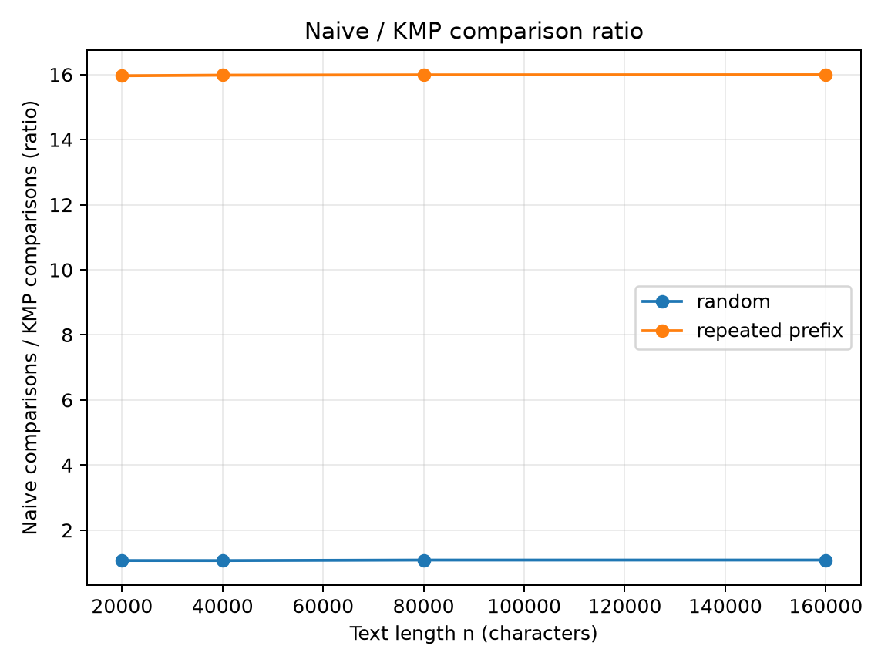

# Assignment 4 Report

## Experiment Design Card

| Field | Edit Distance | String Search |
| --- | --- | --- |
| Question | How do recursion, full table, and two rows scale in work and time? | How does KMP compare with naive search on random and adversarial text? |
| Sizes | Recursive: 2, 4, 6, 8. Table and two rows: 64, 128, 256, 512. | Text length: 20,000, 40,000, 80,000, 160,000. Pattern length: 32. |
| Inputs | Seeded random strings and disjoint-alphabet strings. | Seeded random text and pattern; repeated `a` text with `aaaaaaaaaaaaaaaaaaaaaaaaaaaaaaab`. |
| Metrics | Recursive calls or DP cell updates, plus elapsed time. | Character comparisons, including KMP LPS construction, plus elapsed time. |
| Prediction | Recursive work will rise sharply. Both DP versions will fill n² cells. | Repeated prefixes will make Naive much more expensive than KMP. |
| Plots | Work versus n on a logarithmic axis; DP median time versus n. | Comparisons versus text length; Naive/KMP ratio versus text length. |

The generator seed is `20261107`. Every case has five timed runs. The CSV stores every run; the plots use the median time.

## Results

The recursive disjoint case reached 398,593 subproblem evaluations at n=8. The table and two-row versions both performed exactly n² interior updates.

At n=512 on disjoint strings, the median was 2.0614 ms for the full table and 1.3496 ms for two rows. Small timings varied because of JVM warmup and system load.

At text length 160,000 on the repeated-prefix input, Naive made 5,119,008 comparisons and KMP made 320,030.

The repeated-prefix comparison ratio was about 16:1 in favor of KMP. Random inputs produced much closer counts.

## Prediction versus result

The Edit Distance counters matched the prediction. Recursive work grew rapidly on disjoint strings, while both dynamic-programming implementations had the same quadratic cell count. The measured DP times broadly increased with n, with noise at smaller sizes.

The search results also matched the prediction. Naive search repeatedly checked the long common prefix in the adversarial input. KMP reused its prefix function and kept the comparison count close to linear in text length.

## Short answers

The repeated-prefix input was slowest for Naive search because nearly every start matched 31 characters before failing on the final character. KMP avoided repeating those prefix checks.

The recursive version was tested up to n=8. The disjoint n=8 case already required 398,593 recursive evaluations. Repeated calls grew too quickly for larger practical inputs.

Two rows reduce auxiliary memory from O(nm) to O(m) while retaining O(nm) time. The full table keeps all intermediate values, so reconstructing an edit sequence is easier with the table.

For the city platform, KMP is the better choice for long logs because repeated prefixes can make Naive search perform many more comparisons. Both algorithms returned the same positions in the reference and random cross-check tests.

## Time evidence

Each result contains five runs and the plots use their median. Clock measurements still depend on JVM warmup, allocation, and other processes. The counters are deterministic for the fixed inputs, so they are the main evidence for the complexity conclusions.
